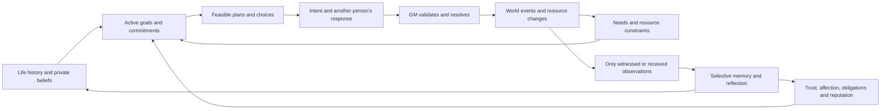

# Smallville+ realism plan

Proposed on 2026-10-22 after the [implementation/trace audit](reports/REALISM_AUDIT.md).
This is the development plan requested by the user, not a claim that these changes
are already built. The original SPEC remains intact. Phase 3 is functionally
complete; the goal of exceeding the original study's realism remains unproven.

## Implementation status — 2026-10-22

Batch 1 implements the R0 measurement foundation and part of R1 behind the
opt-in `connected_v1` profile. It adds owner-scoped campaign evidence, a versioned
evaluation manifest, request/cognition/opportunity diagnostics, durable initial
goals, retention-aware bounded memory and contextual lexical retrieval. A fresh
25-resident artifact with 21 history days completed a one-day offline smoke run
and exact event/state replay. See
[`reports/REALISM_IMPLEMENTATION_1.md`](reports/REALISM_IMPLEMENTATION_1.md).

Batch 2 completes the R1 engineering scope: version 3 cohorts connect household,
work and friendship histories; accepted promises become deadline-bearing goals;
evicted episodes enter a private replayable archive; residents can revise or close
their own goals; and surprises patch only the unelapsed plan around known travel,
closures and appointments. The fixed MockLLM diagnostic recorded 0% full-plan and
repair fallbacks. See
[`reports/REALISM_IMPLEMENTATION_2.md`](reports/REALISM_IMPLEMENTATION_2.md).

Batch 3 completes the R2 engineering scope: bounded phone attention, consent-based
scheduled conversations, independent private turns and departures, directed
evidence-linked social state, decaying social emotion, social-process metrics and
privacy-aware replay inspection. A fresh 25-resident day completed with three
admitted scenes and exact replay. See
[`reports/REALISM_IMPLEMENTATION_3.md`](reports/REALISM_IMPLEMENTATION_3.md).

R3 and later stages have not started. Passing R0–R2 deterministic gates establishes
engineering behavior, not human realism or superiority to the original study.

The immediate priority is to connect motives, memory, interaction and consequences.
Adding more residents, model calls or reference libraries first would amplify the
current limitations. Preserve the working clock, GM authority, privacy, resource
accounting, cache, offline tests and exact replay as the foundation.

## Target behavior

A food shortage should be able to make Carmen reconsider her budget, ask a person
she trusts for help, receive a refusal or an actual meal, remember the encounter,
change her trust and future choices, organize with others and propose a funded
response. Each step needs a real state transition, time cost, observation and
independent choice. The engine must also support the chain failing partway.

A party should involve invitations, replies, conflicts, preparations, travel,
spoken exchanges and later memories. Attendance alone is not the social outcome.
Sam's campaign should persist as his goal while allowing him to postpone or
abandon it; no script should force residents to know about it or support him.

Every edge must be exercised by a test and a recorded scenario. A diary or graph
that never influences choices does not meet this objective.

## Ordered delivery plan

### R0 — Establish trustworthy measurements (first small implementation)

**Work:** Add an observation/evidence ledger separating what happened, who was
exposed, what they accepted as a belief, retained records and answerable recall.
Represent facts with subject, predicate, status, time, source and confidence;
keep quoted testimony distinct from world truth. Correct campaign scoring for
attribution, paraphrase, negation and “considering” versus “declared” candidacy.
Report retained-memory and interview-based awareness separately. Log plan repair,
reflection failures, interaction opportunities and requests by purpose.

**Files:** `eval/metrics.py`, `agents/knowledge.py`, `eval/interviews.py`, event
payloads, a versioned evaluation manifest. Keep old metrics/reports reproducible.

**Gate:** A labeled fixture set covers at least 30 positive/negative/qualified
campaign statements plus unrelated election talk; the Sam/Adam exchange appears
as observed discussion of a possible candidacy. No unaware agent becomes aware
from the scorer. Invalid/unknown judgments are visible. Freeze baseline `b042d8d`
and the current raw log before changing behavior; no improved score is claimed
solely because the definition changed.

### R1 — Activate richer people and repair memory/planning

**Work:** Launch the original 25 through the existing population pipeline with a
recorded digest, biographies and 21-day histories. Improve the template/ring
histories into connected household/work/friendship episodes and unfinished
obligations, with independently scoped memories and reciprocal chronology.
Clearly distinguish generated fictional additions from source facts. Validate
identity, age, chronology, role, family ties and financial/world consistency.

Separate durable identity and *active* goals/commitments from the bounded working
memory stream. Preserve expired episodes in owner-scoped storage; retrieval stays
limited and fallible. Coalesce repetitive “finished” events, retain evidence
links, and retrieve for the current goal, place, person and time. Remove party/
mayor keywords from generic retrieval. Introduce a retrieval interface with a
truthfully labeled lexical fallback; semantic calls must use the shared budgeted
LiteLLM gateway. Do not make every archived fact automatically available.

Expose each resident's own relationship state and relevant promises to decisions.
Represent goal priority, deadline, prerequisites, progress and abandonment.
Repair only the affected future plan when an event matters. Offer actions that
are feasible from the resident's known constraints while retaining GM checks for
hidden facts such as remote stock. Generic refusals should not trigger an entire
new day plan; invalid-plan fallbacks need explicit diagnostics and bounded repair.

**Files:** `personas/`, `agents/memory.py`, `agents/mind.py`, `world/models.py`,
`engine/simulation.py`, `llm/gateway.py`, population/run manifests.

**Gate:** Every rich-cohort resident has a verified history/digest; no claim that
fictional history is an interview twin. Flood a resident with 500 routine events:
identity and an unfinished commitment survive, retrieval remains bounded, and
another person's private facts never leak. A plan handles a missed bus/walk,
closing shop and conflicting appointment without inventing resources. Active
goals can be explicitly revised or abandoned. On fixed diagnostic cases,
invalid-plan fallbacks target below 5% (current run: 55/378 ≈ 14.6%); this is a
provisional engineering target, not a human-realism threshold.

### R2 — Make social interaction an actual process

**Work:** Add a communication-app transport for spoken conversations, preserving
the original requirement that agent communication uses app APIs. It manages
invitation, acceptance/refusal, participants, turns, interruption and ending.
Each participant speaks and decides independently from their own context. The
scheduler books their time, respects existing commitments and permits departure.
Only actual listeners receive utterances; do not broadcast private conversations.
Receiving a phone message should consume attention and allow deferral instead of
automatically reading the entire unread inbox at every activation.

Add bounded social scenes around work, homes and venues: greeting, disagreement,
negotiation, coordination and help requests. Replace substring sentiment with
explicit, evidence-linked appraisal of what happened. Track trust, affinity,
familiarity and obligations separately; changes can be asymmetric. Emotional
effects decay over simulated time instead of disappearing at a zero-time update.
Relations influence future choices without dictating universal politeness,
forced hostility, romance or agreement.

**Files:** new conversation app/service, `apps/phone.py`, `gm/master.py`,
`engine/scheduler.py`, `agents/perception.py`, `agents/drives.py`, relationship
records and viewer scene/thread inspection.

**Gate:** Offline scenarios cover willing, busy and refusing counterparts; a
three-person conversation; interruption; conflicting commitments; false testimony;
and a private conversation with an excluded bystander. No double booking,
unauthorized listener or invented reply. Changing only trust can alter a relevant
choice in a controlled fixture. The negation/emotion counterexamples in the audit
pass. Measure whether live opportunities become actual exchanges; never require
all invitations to succeed or all relationships to improve.

### R3 — Give the GM useful, bounded consequences

**Work:** Extend the Concordia-style split into a registry of typed action
handlers with preconditions, duration, resources, allowed effects and observations.
Introduce persistent scene state and participant roles. Rules resolve clear
cases; the LLM interprets ambiguous intentions into *proposed* validated effects.
Only domain handlers commit changes. Other people's consent and dialogue come
from those people's decisions, not the GM choosing on their behalf.

Start with actions needed by existing stories: give/lend a meal or item,
request/accept a service, arrange/cancel a joint appointment and complete a shared
task. Feed outcomes back into memories, promises and relationships. Replace the
current generic successful `attempt` with a supported causal result, explicit
failure or clearly unsupported intent. Add object/room affordances only where
those actions need them; do not equate new artwork with behavior.

**Files:** `gm/`, `world/models.py`, inventories/objects, `apps/gatherings.py`,
new exchange/commitment APIs, perception and observer routing.

**Gate:** The Carmen shortage scenario can resolve through an accepted meal
transfer, a refusal or a failed attempt, each with exact item conservation and
correct memories. A promise without agreement does not bind someone else. A
successful scene action must expose its committed effect and causal evidence;
unsupported actions never silently report success. Cash/item/time/privacy and
exact replay invariants remain mandatory.

### R4 — Turn the Phase 3 scenario into developing institutions

**Work:** Let residents create a small set of validated proposals, recruit
support, debate alternatives, vote and observe implementation/failure. Permit
bounded delegation and continuing roles with responsibilities. Give shops and
workplaces service tasks, staffing and replenishment decisions. Add household
resource sharing, competing budget priorities and a small number of services/
goods as needed by the scenes. Job changes and negotiated terms follow explicit
contracts and funds; do not add a broad credit/macroeconomic model yet.

Use AgentSociety/MobileCity economy/mobility/routine patterns selectively after
license and API review. Keep these as adapters/ideas; retain our clock/state/GM.
Represent arrivals, known opening hours, admission and service queues consistently
instead of reserving destination occupancy for an entire walk.

**Files:** `economy/`, `apps/civic.py`, `apps/bank.py`, scene/action handlers,
locations and scheduled institutional events.

**Gate:** Residents can originate at least two policy alternatives through
ordinary interaction; quorum, refusal and unaffordable policy paths work. A
staffing or supply shock causes traceable service/budget consequences without
prewritten votes. A no-shock control does not inject the same shortage. Shops do
not sell or produce without their declared resources and service capacity.
Money/stock always reconcile; social outcomes are observed, not forced.

### R5 — Complete original Phase 4: temporal memory and 30-day validity

**Work:** Add owner-scoped temporal graph memory for deep agents and reflective
diaries that update goals/beliefs from evidence. First perform a bounded Graphiti
compatibility spike: verify the current license, Kuzu support, Python APIs and
how extraction/embedding calls can all pass through LiteLLM cost/cache controls.
If that backend is unavailable, report it and keep the tested memory interface;
never silently add a hosted service. Standard agents retain a cheaper bounded
retrieval path. Graph records need event time, belief time, source, confidence,
contradictions and supersession—not omniscient world facts.

Persist scheduler/conditions/in-flight intent state for real resume; use event
deltas and periodic inspection checkpoints to reduce the current near-1-GiB
100-person three-day JSONL. Extend the economy to an explicitly open boundary or
funded production before 30 days: the current finite food/benefit pools are a
three-day stress scenario, not a sustainable closed economy. Record all external
imports/exports rather than silently creating food or money.

**Gate:** Exact continuation after a crash; no duplicate deliveries, wages, model
charges or actions. Owner isolation and temporal queries survive 30 offline days.
Diaries cite evidence and affect a later relevant decision. Drift measurements at
days 0/7/14/30 distinguish stable identity, legitimate change, contradiction and
forgetting. Begin with offline 30-day runs and short live pilots; a long live run
comes only after cost/runtime forecasts and the earlier behavioral gates pass.

### R6 — Original Phases 5 and 6, after behavior earns scaling

Scale to 100 real-model residents, then 1,000+ with sparse activation, indexed
local neighborhoods, measured context budgets and archetype background residents.
Treat AgentTorch-style crowd surrogates as an approximation and evaluate bias
against full agents. Use provider batch APIs only for independent offline work,
not causally dependent live dialogue. Then add OASIS-style social media as another
communication app, with ownership, attention, moderation/ranking assumptions
and diffusion measurement. It cannot replace local human interaction.

**Gate:** Report events/second, p50/p95 decision lag, memory/disk growth and
USD/resident-day with an equal-quality baseline. Validate mixed-model cohorts
separately; an override flag alone is not heterogeneous cognition. Preserve
privacy and causal ordering under load. No scale or social-network realism claim
rests solely on a run completing.

## How we will decide whether realism improved

Use three different kinds of evidence, with separate pass/fail meanings:

| Evidence | Required checks | What it establishes |
| --- | --- | --- |
| Engineering correctness | Offline tests, privacy, time/stock/money invariants, replay/cache/crash recovery | The mechanism works as specified |
| Behavioral adequacy | Labeled micro-scenarios for commitments, recall, refusal, repair, conflict, cooperation and different roles | The mechanism can produce required behaviors without scripting live outcomes |
| Research validation | Controlled baselines/ablations, human ratings, held-out survey fidelity, conditional time-use and multi-seed runs | Whether behavior is more plausible and generalizes beyond the fixtures |

Freeze an experimental manifest before collecting results: code/model versions,
cohort/population digest, map, horizon, seeds, prompts, sampling, feature flags,
cost caps, metrics and exclusions. Report paired differences with uncertainty;
use seed/run as the replication unit, not thousands of correlated action events.
Preserve failures and canceled runs. Do not tune against held-out answers.

Start cheaply: labeled offline cases, then small live scene pilots. For a full
candidate, use the same 25 residents and three seeds for paired three-day baseline
and candidate runs. Six runs at the observed runtime would already take roughly
18 active hours before added social calls; this is a planning estimate, not a
promise. Run broader ablations only when pilot evidence justifies them. Never
reuse cached outputs as if they were fresh independent replications.

For Park-style comparison, also run a separate two-day protocol matching the
published seed information, party window and evaluation questions as closely as
possible. Report remaining differences in model, initial network, action space
and communication. Replicate a local baseline from licensed original patterns
where feasible; do not claim exact replication if the original model/setup is
unavailable. Report original published figures as context, not directly matched
controls. Do not optimize attendance or network density as ends in themselves.

Use blinded human judgments of plausibility, consistency, memory, motivation,
interaction and response to surprises, with multiple raters per vignette and
counterbalanced presentation. A provisional claim gate is a positive paired
improvement whose 95% uncertainty interval excludes zero, with no material
privacy/invariant failure or collapse in identity consistency. Determine sample
size from pilot variance; do not invent a human-believability score if ratings
are unavailable. No automatic model judge alone proves the claim.

For survey fidelity, run the existing held-out Twin/GSS harness on actual model
responses and report coverage, baseline comparisons and uncertainty. Demographic
GSS proxies are not the restricted interview bank. For daily life, compare
age/employment/day-type-conditioned time-use distributions and sequences, not
just a town-wide mean against all US adults. For diversity, measure choices and
opinion changes, within-person consistency and between-person variation; the
initial random opinion variance is not the outcome.

## Cost and runtime discipline

- Keep all generation, embeddings, semantic assessment and graph extraction
  through the same LiteLLM gateway, reservation ledger and exact response cache.
  Preserve existing env-only keys and the authorized free-route $0 cap. A new
  paid service/model needs the user's approval after a concrete proposal.
- Retain event-driven activation. Continue chosen routines until a meaningful
  interruption; avoid regenerating the entire day for every message or refusal.
- Store time/context-purpose diagnostics and latency percentiles. Budget separate
  categories for routine choices, social exchanges, planning, reflection and
  evaluation; fewer low-value calls should fund richer interactions.
- Use compact structured observations and task-relevant memory; preserve stable
  prompt prefixes. Evaluate compression with ablations so savings do not silently
  remove important relationship or goal context.
- Bound conversation length and independent request concurrency. Optimize storage
  and real resume before long runs. Do not promise 4× end-to-end speed from four
  provider slots; causal conversations are sequential.

## Immediate next implementation boundary

The next development batch should be **R0 plus the core R1 repairs**: trustworthy
awareness/goal measurements, durable goals versus working memory, contextual
retrieval, visible own relationship state, plan diagnostics, and an explicitly
rich 25-person cohort. Then implement R2/R3 and exercise the two concrete social
scenarios before another full three-day experiment. R4–R6 remain sequenced work,
not a request to build every feature in one session.

This audit/planning task is complete when the diagnostic artifact, code-linked
findings, ordered work and acceptance gates are saved. Product behavior remains
the measured Phase 3 baseline until implementation is separately requested.
