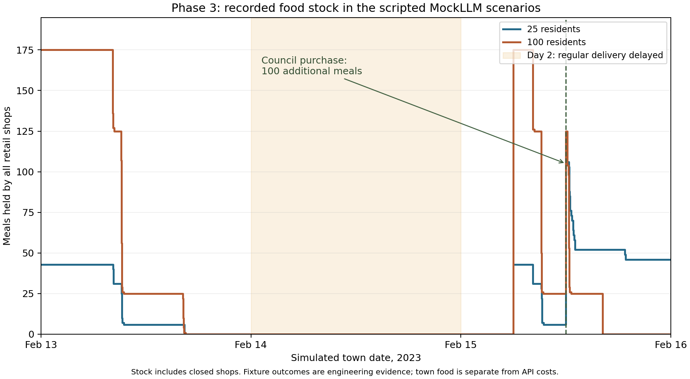

# Phase 3 — Economy, council and three-day experiments

**Implementation and both offline scenarios are complete. The final live API
experiment is running; its final results are pending.** No Phase 4 work was
started and no paid service was added.

## Built

- Integer-cent account transfers and a ledger, paid work with shift/daily limits,
  fractional-cent carry, finite employer funds and unpaid-wage obligations.
- Shared household rent, arrears, funded pension/support allowances, three
  priced food shops, portable meals and finite funded wholesale replenishment.
- Private bank transfers/statements, public notices, evidence-backed local news,
  secret council ballots, quorum/deadlines and a funded food-stock policy.
- Shared event invitations and host/date/venue checks for confirmed attendance.
  The earlier written-time invitation parser defect is corrected.
- Private, dated stock observations, new action prompts/MockLLM fixtures,
  economic audits, historical viewer panels and command/report integration.

Economic rates, capital, support and freelance demand are authored assumptions.
The scenario explicitly delays the second day's regular food delivery. Town
cents and real API USD are separate accounting systems.

## Completed offline scenarios

| Measurement | Original 25 | Expanded 100 |
| --- | ---: | ---: |
| Simulated days | 3 | 3 |
| Minutes per resident | 4,320 | 4,320 |
| Mock requests | 3,317 | 14,076 |
| USD / resident / day | $0 | $0 |
| Wall seconds | 389.783 | 2,260.967 |
| Recorded events | 14,528 | 59,768 |
| Rent arrears, town cents | 0 | 27,081 across 11 residents |
| Hungry residents without meals at end | 0 | 14 |
| Failed purchase attempts/completions | 71 | 191 |
| Confirmed party guests / receiving details | 12 / 20 | 31 / 46 |

These are deterministic scripted fixtures, including their social decisions and
synthetic token counts. Wall times include competing validation work. They
demonstrate implementation behavior, not human realism or emergent politics.

Both scenarios conserve all money and meal units, respect work limits, keep
accounts nonnegative and reconcile every account with its transfer ledger.
In the 100-resident run, 19,873,747 cents remain conserved and 974 initial meals
equal 461 consumed plus 513 remaining. Fourteen residents are hungry without
food despite remaining town supply; the fixture exposes access/affordability
pressure rather than automatically solving it.

The council fixture passed its proposal in both towns. The 25-person vote was
15 yes, 5 no, 5 abstentions; the 100-person vote was 67 yes, 22 no, 11 abstentions.
Each policy spent 30,000 town cents on 100 actual remaining wholesale meals.
The policy adds stock while retail prices remain unchanged.

Retail stocks emptied before the second-day delivery delay. The regular
third-day replenishment and council purchase added actual stock. The expanded
fixture exhausted its retail supply again. [Vector figure](phase3/food-stock.svg)
and [transaction-derived data](phase3/food-stock.csv) are available for inspection.

Party counts are distinct guests over February 14, 17:00–19:00, with host/time
confirmation. They are not simultaneous occupancy. Receiving full shared-event
details is the invitation metric. A host-owned event is seeded from the original
party goal; this setup, three-day horizon and communication channel differ from
Park et al.'s two-day experiment.

## Verification

- **76 tests pass offline**, 173.06 seconds, with internet sockets disabled.
  Ruff and formatting pass for 59 Python files.
- The additional Phase 3 cache regression uses **443/443 cache hits**, zero
  provider calls and identical world state except the replay configuration flag.
- Both complete event imports reproduce every table and JSONL bytes exactly,
  without inference. All agents account for every simulated minute.
- Chromium checked the historical finance/contract/council interfaces with no
  page errors or external requests. [Viewer screenshot](phase3/viewer.png).

Offline scenarios began at `4525c58`. Later changes correct news read cursors,
CLI validation and derived initial-awareness counting; reports were recomputed
from unchanged event histories. Final production behavior is frozen at
`87778b4` for the API experiment.

## Live API experiment — pending

The original 25 residents are running for three days on the authorized
`openrouter/minimax/minimax-m3.1-flash:free` route through LiteLLM. Published
prompt/output rates were zero; the gateway cap and provider price ceiling remain
zero, with no retries or paid fallbacks. Keys enter only the process environment
through hidden input. [Settings](phase3/live-settings.json) contain no key.

Two early API diagnostics were interrupted while correcting offline-discovered
stock and contract issues: **83 attempts, 81 known responses and two uncertain
interrupted requests, $0**. These remain separate from the final runtime. Unknown
usage for interrupted requests is not reported as measured tokens.

Current progress is in the local `reports/phase3/live-progress.json`. Final
duration, real token usage, behavior, failure status and replay checks will be
recorded after the run ends. Published-rate accounting is not a provider invoice.

## Problems found and limits

Fixed lost shop-stock observations, teacher/student and unpaid-work
classification errors, part-time limits, same-minute news loss, duplicate initial
awareness counting, shared-event date validation and incomplete interruption
status. Early diagnostics and their costs remain retained.

Remaining limits include fixed prices and primary contracts, one meal commodity,
automatic prorated rent, simple emotional/relationship heuristics, scarce-venue
retry behavior and a fixed council proposal. There is no labor market, eviction,
credit, full inventory trading or calibrated macroeconomy. Full state snapshots
are expensive: the expanded three-day JSONL is about 954 MiB.

No blinded human ratings, matched paper replication, live 100-resident cohort,
paid-price validation or 1,000-agent load test was performed. These results do not
establish that Smallville+ exceeds the original paper's realism.

Evidence: [offline checks](phase3/offline-checks.json),
[25-person report](phase3/mock-25-simulation.json),
[100-person report](phase3/mock-100-simulation.json),
[25-person replay](phase3/mock-25-verification.json),
[100-person replay](phase3/mock-100-verification.json).
