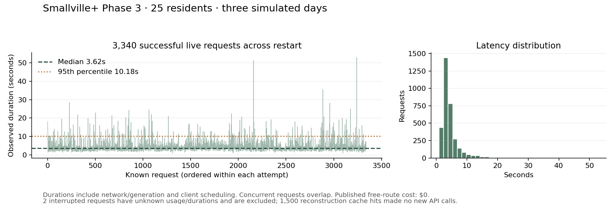

# Phase 3 — Completed three-day simulation

**Evidence labels:** all MockLLM-derived numbers in this report are **fixture only**,
including the offline table. The fixed-delay concurrency probe is also **fixture
only**. Separately identified real-model results used the historical free route;
they do not satisfy the paid-validation requirement in [MILESTONES.md](../MILESTONES.md).

Phase 3 and the performance/planning improvements are implemented. The real-model
experiment completed **25 residents × three days** (4,320 minutes each), using
`openrouter/minimax/minimax-m3.1-flash:free` through LiteLLM. Both optimized offline
scenarios, with 25 and 100 residents, also completed three days. No Phase 4 work
or paid service was added. “Number thing” was interpreted as item 1, performance
and planning, after optional clarification received no answer.

## What was built

- Auditable integer-cent accounts, private bank transfers, paid work with shift
  and daily limits, finite employer funds, fractional-cent carry and unpaid wages.
- Shared household rent and arrears; three priced food shops, portable meals,
  finite stock and funded wholesale replenishment.
- Public notices and evidence-backed local news; private council ballots, quorum,
  deadlines and a policy that spends actual treasury funds on existing meals.
- Shared invitations and validated host/date/venue attendance; dated private
  observations of stock, without remote knowledge of unseen sales.
- Historical finance, work, shop and council panels in the research viewer,
  economic audits, command integration and offline regression coverage.
- Optional `--optimized`: bounded concurrent same-minute decisions, smaller phone
  context, recent rejection feedback, explicit known movement/work constraints,
  request deduplication and separate provider/queue timing measurements.

Chosen work, sleep or leisure can continue for at most two hours, with hourly
checks and interruptions for needs, new information, appointments and GM rules.
Purchases, messaging, voting and attendance still require fresh model decisions.
Independent decisions read a fixed scene; the GM applies results in scheduler
order and rechecks scarce resources. In-flight reservations count against the
hard spending cap. Production inference/world behavior stayed at `8e2b410`.

Economic prices, contracts, support transfers and capital are authored scenario
assumptions. The second day's regular delivery is deliberately delayed. Town
money is fictional and separate from API USD.

## What people did in the real-model run

Residents worked, bought meals, paid rent, exchanged **89 messages**, read town
news and voted. Average daily recorded time was **8.88 hours sleeping, 6.29
working, 4.58 on leisure, 1.76 travelling and 2.48 on other activity**. These are
coarse activity categories, not validated human time-use measurements.

**Isabella hosted the Valentine's party at Hobbs Cafe. Maria Lopez, Ryan Park
and Tamara Taylor attended: three of four guests receiving complete invitations.**
Attendance requires a completed action overlapping the party window and host
confirmation. It excludes the host and is not inferred from a message or map dot.

**The council voted 21 yes and 3 no**, with 24 of 25 eligible residents voting.
At the day-three noon deadline, the passed policy spent **30,000 town cents
($300 fictional)** to move **100 existing wholesale meals** to the market.
Retail prices did not change. Seven public notices were published, with all
25 residents reading news at least once. Carmen also posted requests for spare
meals for herself and Tamara; a request alone does not establish a successful
food transfer.

Wages totaled **646,206 town cents**, rent **140,400**, meal purchases **78,600**,
pension/support **73,500**, and personal transfers **1,200**. All **5,169,371
initial town cents** remain accounted for. The **243 initial meals** reconcile
as **154 consumed + 89 remaining**. No account is negative; account-ledger and
work-limit audits pass. No rent arrears or unpaid wages remained. Three residents
were hungry without meals at the endpoint, and 12 purchase attempts/completions
failed. Remaining town supply does not prove personal access or affordability.

[Complete measurements](phase3/resumed-live-simulation.json) and
[final progress record](phase3/resumed-live-progress.json).

## API cost, interruption and speed

| Whole completed experiment | Measurement |
| --- | ---: |
| Actual provider attempts across both execution attempts | 3,342 |
| Successful recorded provider responses | 3,340 |
| Interrupted requests with unknown usage | 2 |
| Known input tokens | 13,105,152 |
| Known output tokens | 794,401 |
| Published-rate API cost | $0 |
| API USD per resident per simulated day | $0 |
| Active execution wall time, lower bound | 10,787.017 seconds (about 3 hours) |
| Median successful request duration | 3.62 seconds |
| 95th percentile request duration | 10.18 seconds |

The exact authorized route had zero listed input/output prices. Both gateway
`SIM_MAX_USD` and provider price ceilings were zero, with no retries or paid
fallbacks. This is published-rate accounting, not a provider invoice. Unknown
usage is excluded from known token totals; it is not presented as zero usage.
No secrets are saved in reports, code or logs.

The environment restarted on day two at minute **2,490**. The first attempt
preserved **1,500 successful responses and two uncertain in-flight requests**.
Recovery rebuilt the known prefix locally and verified every world projection
against the original checksum **before its first new API request**. It then made
**1,840 new successful calls** and reached minute 4,320. Completed provider calls
were not repeated. The resumed run's own ledger includes 1,500 reconstruction
cache hits; its token totals cover only the new requests. Use the report's
`whole_experiment_cost` for combined accounting. Viewer counters describe the
resumed attempt, not the sum of both provider journals.

The resumed attempt took 6,258.347 seconds, including cache reconstruction. The
combined lower bound adds the last observed 4,528.67 seconds before interruption;
exact shutdown time and the outage duration are unavailable. It is not an exact
uninterrupted-run speed measurement. Recovery reconstructs from responses;
there is still no directly resumable persisted scheduler.

Concurrency is bounded at four, but only independent decisions at the same
simulated minute overlap. Most groups are smaller; thousands of requests taking
several seconds still accumulate. Full world snapshots and local SQLite/JSONL
work also cost time. The optimization changes attention/history limits and
routine timing, so behavioral equality with earlier unoptimized runs is not
claimed. A synthetic fixed-100ms gateway probe showed 4.07× throughput; this is
not a real-API or whole-engine speedup.

[Timing summary](phase3/resumed-live-latency-summary.json),
[request data](phase3/resumed-live-latencies.csv),
[vector figure](phase3/resumed-live-latencies.svg),
[recovery manifest](phase3/environment-recovery-manifest.json),
[pre-network checksum proof](phase3/resumed-checkpoint-verification.json) and
[key-free settings](phase3/resumed-live-settings.json).

## Offline validation and comparison

**83 tests passed with internet sockets disabled**, in 142.49 seconds. Ruff passes.
A subsequently strengthened populated-history/privacy case also passed offline;
no simulation code changed. Tests cover budget races, deduplication, concurrency,
cancellation, ordered capacity, partial observability, routines and replay.

| Optimized three-day fixture only | Original 25 (fixture only) | Expanded 100 (fixture only) |
| --- | ---: | ---: |
| Mock requests | 2,870 | 12,141 |
| Previous unoptimized requests | 3,317 | 14,076 |
| Request reduction | 13.5% | 13.7% |
| Synthetic input-token reduction | 12.0% | 41.5% |
| Wall seconds | 332.999 | 1,686.868 |
| Recorded events | 14,679 | 59,359 |
| Confirmed party guests / receiving details | 12 / 18 | 29 / 49 |
| Rent arrears, town cents | 0 | 23,081 across 11 residents |
| Hungry residents without meals at end | 0 | 11 |

Both fixtures conserve money/food, reconcile all accounts, respect work limits
and account for every resident's 4,320 minutes. Both full event imports reproduce
identical world state and byte-identical JSONL without inference. Mock social
choices and token counts are scripted diagnostics. Wall-time comparisons had
different competing work and do not isolate the optimization's causal effect.
The 100-person cohort uses the existing Phase 2 full-history population artifact;
the live cohort uses the original 25 seed workflow, without those digital histories.
There is no live 100-resident result.

[Offline checks](phase3/optimized-offline-checks.json),
[fixture comparison](phase3/optimized-fixture-comparison.json),
[25-person fixture](phase3/optimized-mock-25-simulation.json),
[25-person replay](phase3/optimized-mock-25-verification.json),
[100-person fixture](phase3/optimized-mock-100-simulation.json) and
[100-person replay](phase3/optimized-mock-100-verification.json).

The completed real-model run's **16,149 events** import to identical state and
byte-identical JSONL. All 25 residents account for every minute, and all five
economic audits pass. A separate full three-day cached rerun used **3,340 cache
hits and zero provider calls**, reproducing every world table except the explicit
replay configuration flag. No fresh API inference was used for either check.

[Real-run event verification](phase3/resumed-live-verification.json) and
[full cached rerun](phase3/resumed-live-cache-verification.json). Event-log SHA-256:
`00f977f2ae32d08c58b1369726bb2c26011e4bc2bbfb0217c22e35bf5b98b452`.

## Original Smallville comparison and limits

| Measurement | Completed real-model run | Park et al. |
| --- | ---: | ---: |
| Sam campaign awareness retained at end | 0 / 25 | 8 / 25 |
| Party awareness retained at end | 5 / 25 | 13 / 25 |
| Invited guests attending | 3 / 4 | 5 / 12 |
| Mutual-knowledge density | 0.233 → 0.243 | 0.167 → 0.740 |

Our awareness measure uses retained memory evidence, not paper-style interviews;
Sam's seeded evidence was no longer retained at the end. A subsequent read-only
audit found that the narrow phrase detector also misses Sam telling Adam he is
considering a mayoral run and Adam's encouragement. The reported zero is therefore
not proof of zero knowledge; candidacy status, attribution and recall need separate
measurement. See [audit evidence](realism/phase3-audit.json). The horizon is three
days rather than two, the initial network differs, a host-owned party event is
seeded, communication uses phone apps, and models/contexts differ. Guest counts
are distinct over the party window rather than simultaneous occupancy. These
are descriptive comparisons against [paper §7.1](https://arxiv.org/html/2304.03442v2#S7.SS1),
not a matched replication or proof of better realism. No blinded human ratings
or extra live interview calls were collected.

The GM still rejected **32 closed-destination attempts**, nine activities that
would overrun closing, fourteen unsupported action arguments, five attempts
without a matching event, and other invalid intentions. Refusal feedback helps
expose these problems but has not eliminated them. Needs/emotions/relationships
remain simple heuristics; opinions start from synthetic heterogeneous priors.

Prices and primary contracts are fixed. There is one meal commodity, automatic
prorated rent, a fixed council proposal, and no labor market, eviction, credit,
full inventory trading or calibrated macroeconomy. Movement admission reserves
capacity at departure and does not simulate detailed queues. Full snapshots are
expensive: the optimized 100-person three-day JSONL is about **995 MiB**. No
1,000-agent load test, 30-day drift validation or human realism improvement was
established. Graphiti and the social-media layer remain later-phase work.

## Viewer and retained earlier attempts

Chromium verified all 25 resident controls, the selected notebook, correct
real-model source wording, final completion and party-time replay, with no page
errors or external requests. This is a schematic of the original tile map;
researchers can inspect private notebooks, but residents cannot.

[Final town screenshot](phase3/resumed-live-viewer.png),
[party-time screenshot](phase3/resumed-live-party-viewer.png) and
[browser evidence](phase3/resumed-live-browser-check.json).

The previous user-stopped live run remains interrupted at minute 1,260. It used
947 attempts (946 known responses, one uncertain); two earlier diagnostics used
83 attempts (81 known, two uncertain). Their **1,030 attempts and three uncertain
requests**, all at $0, remain separate from the new completed experiment's
3,342 attempts. The interrupted optimized prefix is also preserved; its costs
are already included once in the completed experiment's whole-experiment totals.
Earlier offline measurements and plots remain historical artifacts, not final
optimized results. No interrupted attempt is relabeled as completed.

[User-stopped report](phase3/live-simulation.json),
[earlier diagnostic](phase3/diagnostic-live-simulation.json),
[stock diagnostic](phase3/stock-diagnostic-live-simulation.json) and
[environment-interrupted prefix](phase3/optimized-interrupted-live-simulation.json).
